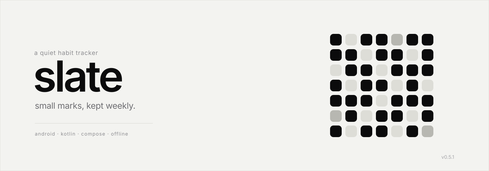

<p align="center">
  
</p>

<p align="center">
  <a href="https://github.com/quipmug/slate/actions/workflows/android.yml"></a>
  <a href="https://github.com/quipmug/slate/releases/latest"></a>
  <a href="LICENSE"></a>
  
</p>

<p align="center"><em>small marks, kept weekly.</em></p>

<p align="center">
  <a href="https://github.com/quipmug/slate/releases/latest">download</a> ·
  <a href="docs/architecture.md">architecture</a> ·
  <a href="CHANGELOG.md">changelog</a> ·
  <a href="LICENSE">license</a>
</p>

**slate** is a quiet, monochrome habit tracker for android. a weekly view, day by
day check-ins, a year of small marks, and nothing else.

most habit apps add more: streaks you can buy, feeds, badges, accounts, clouds.
slate removes instead. one screen for the week, one square for each day, one
honest record of what you kept.

## what it does

- **the week** — one row per habit, one softened square per day, monday to sunday
- **the trail** — the last 53 weeks on every habit card, drawn as a small grid
- **the year** — a compact heatmap of every day you kept, all habits or one by one
- **the target** — 1–7 check-ins a week, with past weeks always editable
- **the details** — streak, weekly target, rename, delete, and a quiet history
- **the reminder** — one optional daily nudge, scheduled at a time you choose
- **strict focus** — selected apps close for 1h, 4h, 8h or 24h, then come back on their own
- **the look** — light, dark and auto themes, all monochrome, all lowercase
- **the data** — local room database only. no account, no cloud, no tracking, no internet permission.

## what it isn't

| it is | it isn't |
|:--|:--|
| a weekly ritual | a social network |
| a local file on your phone | a cloud service |
| a quiet record | a dashboard with a thousand charts |
| deliberately small | feature-complete for everyone |

## design

- palette: paper `#f3f3f0`, ink `#0b0b0c`, night `#09090a`, dark surfaces
  `#17171a`, hairlines `#2b2b30`, secondary text `#a6a6aa`
- font: inter, bundled in the app; tabular numerals everywhere numbers matter
- no uppercase labels, no gradients, no shadows, no decorative noise
- rounded-square days, one-canvas heatmaps, hairline cards, 48dp touch targets
- a floating bottom dock with habits, year and settings
- quiet motion only: the first-run grid fill, week changes, day fills, the
  back-to-week reveal, dock pills and screen fades
- english dates on every phone, so the grid always reads the same way

## strict focus

focus is optional and off until you enable it in settings. choose the apps that
should close, pick a duration, and confirm. while the timer runs, the selected
apps are sent home as soon as they open. there is no stop button in slate; the
timer ends on its own, then the apps work normally again.

the blocker uses android's accessibility service. slate only reads which package
is in front, never what is on screen. settings, the dialer, the launcher, system
ui, the installer, the permission controller and slate itself can never be
blocked: the service re-checks that list whenever it is about to close an app,
so a stale list cannot lock the phone.

to enable the service, open settings → focus → turn on. on android 13 and newer,
a sideloaded copy may first need app info → “allow restricted settings”. the
service can always be turned off again in android accessibility settings, so the
timer is strict, not impossible to escape. this is an independent implementation;
slate does not integrate with digital wellbeing or samsung health.

## privacy

slate has no network layer. the manifest requests no `INTERNET` permission and
`allowBackup` is off. habits live in a local room database, while settings and
the focus list live in a local datastore file. a one-time migration moves habits
from the older datastore format into room, so updates keep your history.
uninstalling the app removes everything. notifications are optional and only
ever say that a habit is still open.

## download

get the latest apk from [releases](https://github.com/quipmug/slate/releases/latest).

1. open the apk on your phone, or run `adb install -r slate-debug.apk`
2. allow installs from the app you used to transfer the file, if asked
3. open slate. the first run is a small grid, then the week.

## build

requirements: jdk 17, android sdk with platform 35 and build-tools 35.0.0.

```bash
./gradlew assembleDebug
./gradlew testDebugUnitTest
./gradlew lintDebug
```

the apk lands in `app/build/outputs/apk/debug/app-debug.apk`. the github action
runs the same three commands on every push to `main`, and a `v*` tag also
publishes a release with the apk and its sha256 file.

## under the hood

a single module, one activity, one view model. hilt wires the dependencies,
navigation compose owns the five routes, room stores habits, and datastore keeps
settings. there is no network stack.

- `data` — room entities, dao and database, a one-time datastore-to-room
  migration, pure `HabitRules`, and the settings flow over datastore
- `domain` — pure week progress, streak, year count, heatmap grid and focus timer
  functions
- `focus` — accessibility service and the small helper that reports whether it is
  enabled
- `reminder` — one-time work that reschedules itself after every run; the
  notification builder is shared with the settings test action
- `ui` — stateless screens, one `@HiltViewModel`, navigation compose routes and
  the selected week survive rotation; the 53-week trail is cached as a bitmap so
  scrolling stays cheap

see [docs/architecture.md](docs/architecture.md) for the file-by-file map.

## stack

kotlin · jetpack compose · material 3 · hilt · room · navigation compose ·
datastore · kotlinx.serialization · workmanager. no analytics, no network.

## tests

28 plain unit tests cover dates, habit rules, week progress, streaks, reminder
timing and focus timers. lint passes with warnings only: mostly newer dependency
versions available to a newer toolchain, plus `PluralsCandidate`, `ObsoleteSdkInt`
and the lowercase `cancel` label.

## license

code is MIT, see [LICENSE](LICENSE). the bundled inter font is licensed under the
SIL open font license, see [licenses/Inter-OFL.txt](licenses/Inter-OFL.txt).
